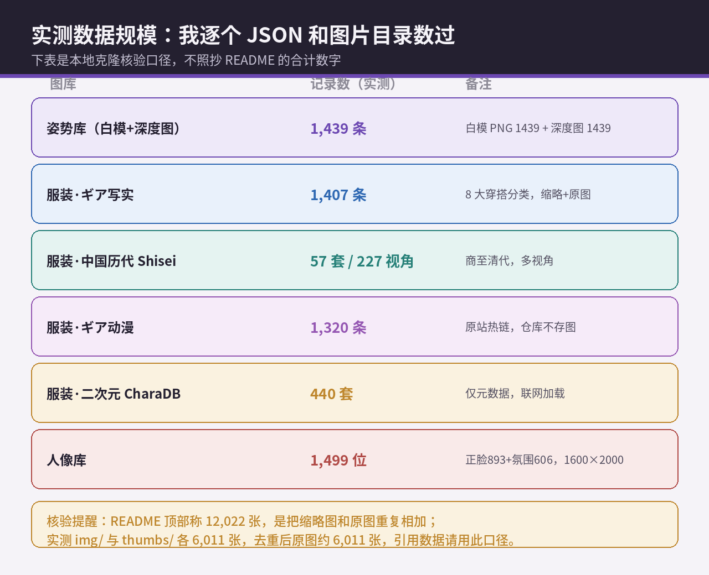
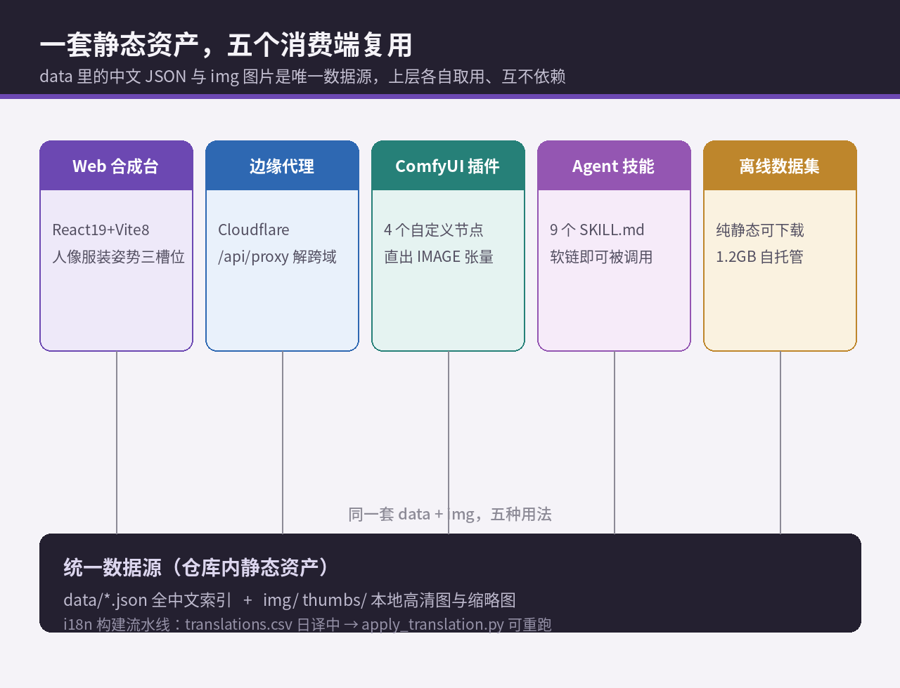
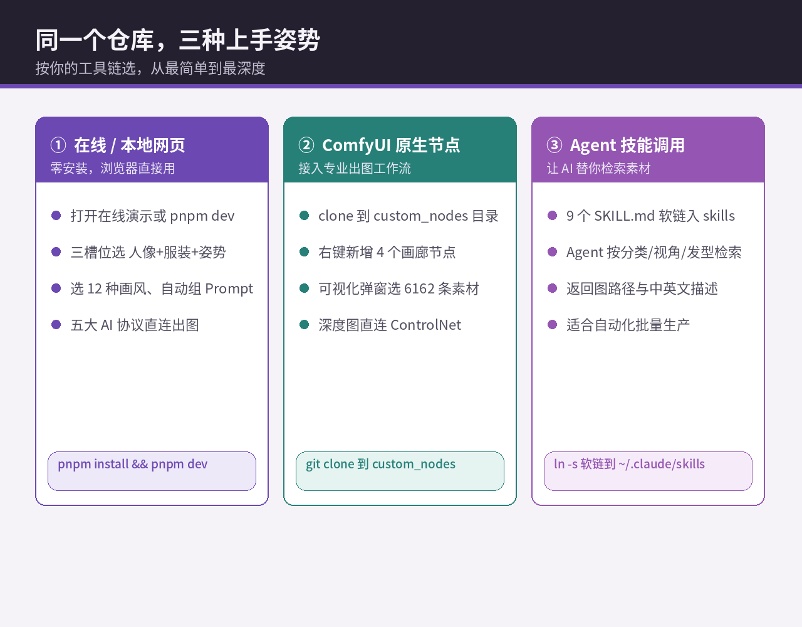
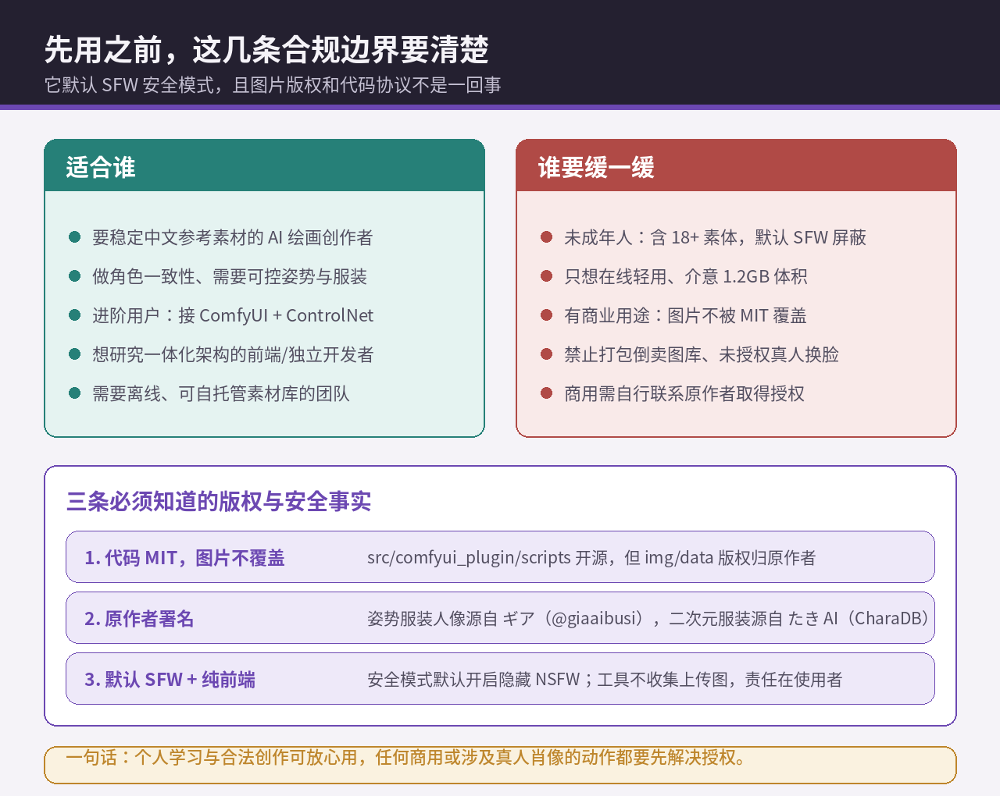

评价这个项目之前，我先把整个仓库（不含 .git 约 1.2GB）克隆到本地核验了一遍，因为它的 README 信息密度很高、统计口径也有值得商榷的地方。先说结论：ai-pose-gallery-zh 的价值不在"图库"本身，而在于它把原本分散在三个日文站点、需要人工搬运翻译的 AI 绘画参考素材，重构成了一套数据本地化、全中文索引、并能同时服务网页、ComfyUI 和 AI Agent 的生产工具。

## 一、先纠正一个数据口径

README 顶部宣称本地有 12022 张高清图，但我实际数 `img/` 和 `thumbs/` 两个目录，各是 6011 张。拆开看：姿势白模 1439、深度图 1439、写实服装 1407、历代服装 227 个视角、人像 1499，加总正好 6011。所谓 12022，是把原图和缩略图重复相加了，它们本质是同一批素材的两种尺寸。更准确的口径是约 6011 张原图，配套等量缩略图。

主库的记录数本身是可靠的：姿势 1439 条、写实服装 1407 条、人像 1499 位，另有动漫服装 1320 条、中国历代服装 57 套（227 视角）、二次元 CharaDB 440 套。需要注意动漫和二次元两类只存元数据、图片走原站热链，这是它能把体积控制在 1.2GB 的关键。

## 二、核心是"一份数据、五端复用"的架构

这个项目最值得分析的不是素材数量，而是它的架构。底层只有一套静态资产——`data/` 里的全中文 JSON 加上 `img/`、`thumbs/` 的图片，在这之上长出五个互不依赖的消费端：React 合成台、Cloudflare 边缘代理、ComfyUI 原生插件、九个 Agent 技能、以及可整体自托管的离线数据集。

它的汉化方式体现了真正的工程思维。维护者没有靠人肉逐条翻译，而是用日译中词典加一份 474 条的 `translations.csv` 对照（例如"2人絡み"对应"双人缠绵"），再通过 `apply_translation.py` 一键生成全部中文 JSON。翻译被做成可重跑的构建步骤而非一次性手工活，上游原站更新后重新跑脚本即可，这是一个人能维护六千多条数据的根本原因。

合成台用 React 19 + Vite 8 + Tailwind 4 构建，核心是人像、服装、姿势三个槽位（姿势支持白模与深度图切换）加任意附加参考图，内置 12 种画风并自动组装中英文提示词，生成历史用 IndexedDB 持久化以避开 localStorage 的容量限制。生图通道接了 Gemini、GPT Image、通义 Qwen、豆包 Seedream 和本地 ComfyUI 五个，针对千问、豆包的浏览器跨域问题，用 Cloudflare Workers 的 `/api/proxy` 做同源代理并带域名白名单。

## 三、ComfyUI 插件与 Agent 技能是它的差异化

普通素材站止步于"看图选图"，这个项目向生产链路延伸了两层。

我读了 `comfyui_plugin/nodes.py` 源码，确认它真实注册了四个节点：姿势、服装、人像和三合一配方，能在 ComfyUI 画布直接输出 IMAGE 张量与中英文 Prompt，姿势节点的 `use_depth` 开关让深度图可以直接接入 ControlNet Depth，且复用 ComfyUI 自带依赖、无需额外安装。

另一层是 `skills/` 下九个 SKILL.md 格式的 Agent 技能，软链到 skills 目录后，AI 就能按分类、视角、发长检索素材并返回图片路径。代码规模也印证了它的工程体量：前端 67 个 ts/tsx 共 11841 行、插件 1610 行、数据脚本 1342 行，不是套壳静态页。

## 四、合规边界比功能更需要被强调

这个项目包含部分成人向素体和性感穿搭，评估时不能只看技术。

第一，代码协议与图片版权是分离的。GitHub 将其 license 识别为 NOASSERTION，因为 `src`、插件、脚本是 MIT，但 `img`、`data` 里的素材不被 MIT 覆盖，版权归原作者 ギア（@giaaibusi）和 たき AI，明确禁止打包倒卖。第二，NSFW 分类默认由 SFW 安全模式隐藏，未成年人被要求不得解锁，但这只是软件开关而非物理删除。第三，工具纯前端、不收集上传数据，但未经授权的真人换脸、深伪责任完全在使用者。

## 五、适用判断

需要稳定中文参考素材、做角色一致性、要把参考图接入 ComfyUI + ControlNet 的 AI 绘画创作者，以及想学习"静态站加边缘函数加本地插件加 Agent 技能"一体化架构的开发者，能从这个项目获得明确价值。

两类人应当谨慎：介意 1.2GB 克隆体积、只想要在线轻量工具的人，直接用网页演示即可；有商用或出版需求的人，必须先意识到图片不被 MIT 覆盖，任何再分发或涉及真人肖像的使用都要先解决授权。

一个旁证是它的 fork 数达到 2040，约为 star 数的 26%，远高于一般展示型仓库。这种异常高的 fork/star 比说明用户不是在收藏，而是真的要把数据和工具拉到本地运行——对一个参考素材类项目而言，这比 star 数更能说明它的实际效用。

项目地址：https://github.com/anhao/ai-pose-gallery-zh
