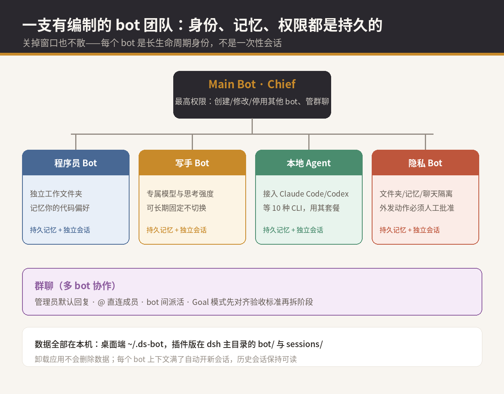
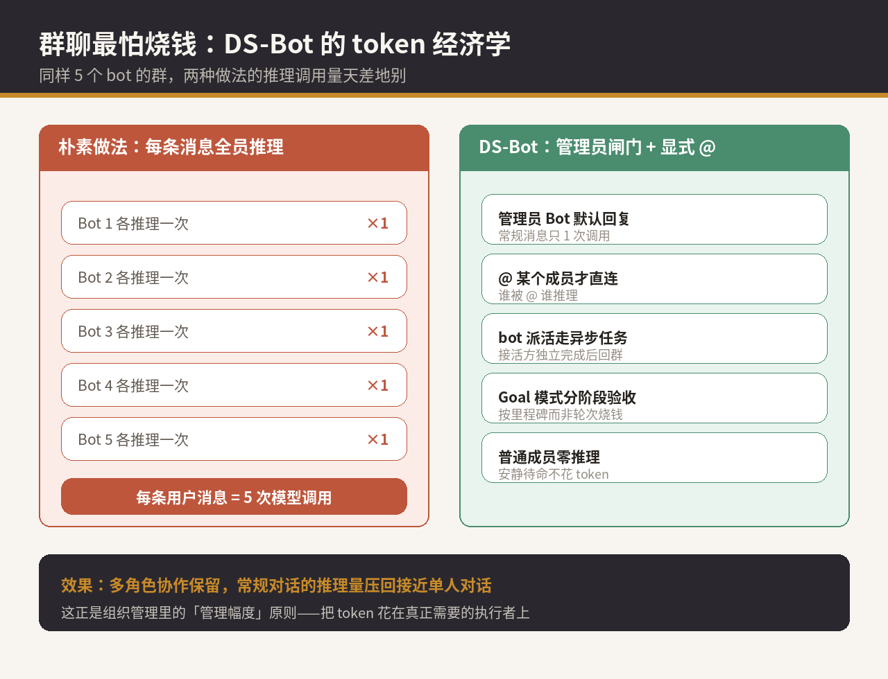
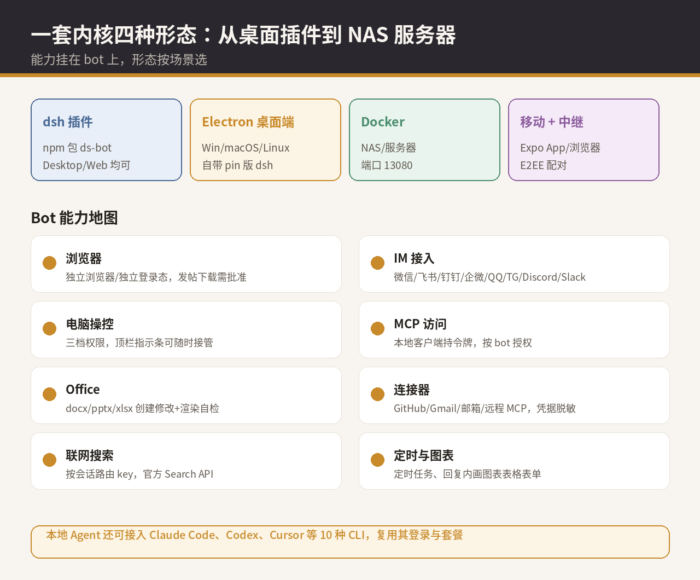
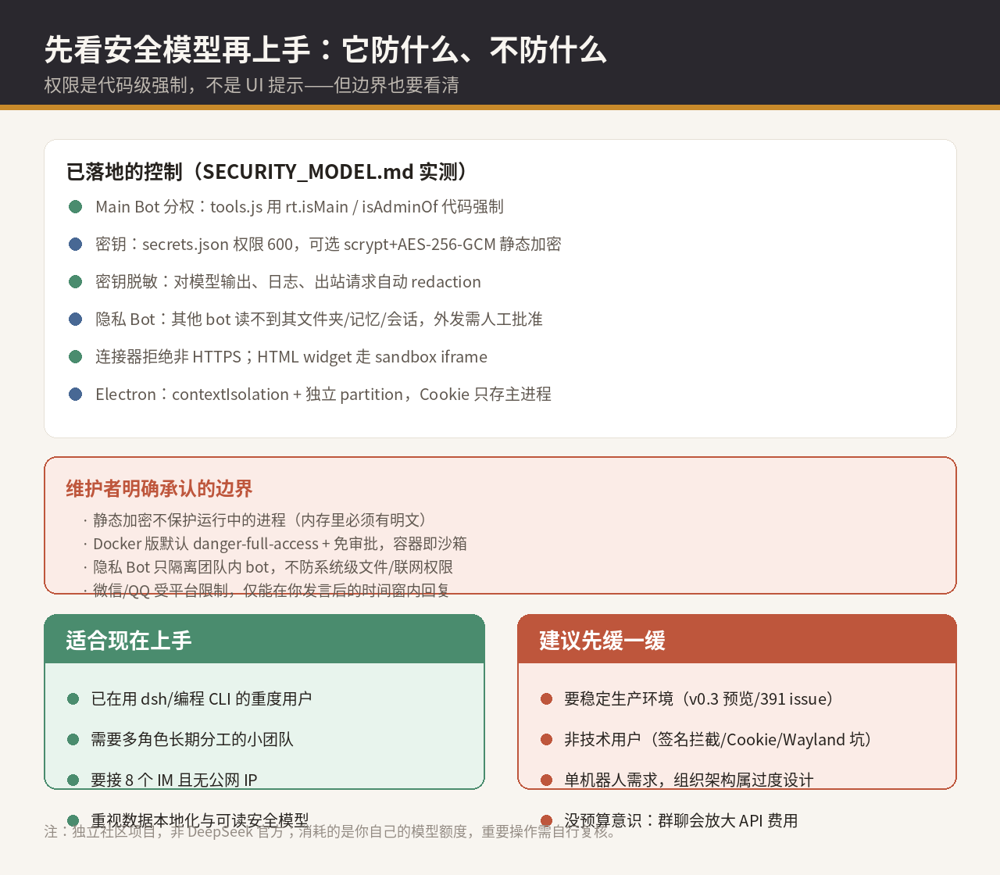

评价 DS-Bot 之前，我先把仓库克隆到本地逐文件核验了一遍。这个项目容易被简单归为"又一个多 agent 框架"，但实际定位更具体：它是 DeepSeek Harness（dsh）的插件化扩展，把单人使用的 agent harness 改造成一支长生命周期的 bot 团队。仓库已从个人账号 Fei2411 迁移到 Fei-Craft 组织，目前 8885 Star、903 Fork，Apache-2.0，且明确声明是独立社区项目、不是 DeepSeek 官方产品。

## 一、核心差异：持久身份取代一次性会话

通用多 agent 框架通常提供创建 agent、交接任务这类编排原语，但 agent 默认是短命的：会话结束身份消失，记忆、权限和工作上下文没有稳定承载。DS-Bot 把 bot 定义为持久身份，每个 bot 拥有独立记忆（Markdown 存储、可对话管理）、独立工作文件夹、权限预设和模型配置，上下文满后自动开新会话而历史会话保持可读。

权限模型值得单独看。Main Bot（默认名 Chief）拥有创建、修改、停用其他 bot 及管理群聊的最高权限，普通 bot 无法获得这些能力。这套分权不是界面隐藏，而是在服务端 tools.js 中通过 rt.isMain、rt.isAdminOf 做代码级强制。另有隐私 bot 形态：其文件夹、记忆和会话对其他 bot 不可见，外发消息或写外部文件必须人工批准，删除后保护仍持续到用户手动解除。

## 二、群聊设计的关键变量是 token 成本

多 agent 群聊在工程上的主要矛盾不是能不能对话，而是成本失控：若每条用户消息都触发所有成员推理，调用量随 bot 数量线性增长。

DS-Bot 采用管理员闸门机制：群聊必须设置管理员，普通消息默认只由管理员回复并由其调度其他成员；用户显式 @ 某 bot 时才直连唤醒；bot 之间派活走异步任务，接活方独立完成后把结果发回群内；未被触发的成员保持零推理。复杂任务可启用 Goal 模式，先由管理员与用户对齐验收标准，再拆成阶段分配并逐段验收。其效果是保留多角色协作形态的同时，把常规对话的模型调用压回接近单人对话水平。群聊还拥有独立记忆和工作文件夹，群外 bot 无法访问。

## 三、四种部署形态与能力边界

实测仓库并非单一插件，而是同一套内核的四种交付：dsh 插件（npm 包 ds-bot，支持 Desktop 与 Web）、Electron 桌面应用（Windows/macOS/Linux，自带锁定版本 dsh 与独立 DSH_HOME，可只读导入既有 ~/.dsh 团队）、Docker 镜像（NAS 与服务器，13080 端口）、Expo 移动端加 link 中继（支持浏览器远程访问，端到端加密配对，浏览器密钥存于 IndexedDB 且不可导出）。

能力模块包括：每 bot 独立浏览器与登录态、发帖下载等敏感动作人工批准；电脑操控三档权限与顶栏接管指示；docx/pptx/xlsx 的创建、修改与渲染自检；8 个 IM 平台接入（微信、飞书、钉钉、企业微信、QQ、Telegram、Discord、Slack），无需公网 IP；MCP 访问（默认关闭、按客户端发令牌、按 bot 授权）；GitHub 与邮箱连接器、定时任务和回复内图表。

另一个差异化能力是本地 Agent 接入：Claude Code、Codex、Cursor、GitHub Copilot、Devin、OpenCode、Gemini、Antigravity、Kimi、Kilo 共 10 种 CLI 可直接作为 bot 成员，复用 CLI 自身的登录、套餐与模型。限制同样写明：本地 Agent 走 CLI 自有工具链，DS-Bot 的共享连接器不会下发，切换运行方式会新开对话。

## 四、安全模型：成熟之处在于承认边界

项目提供独立的 SECURITY_MODEL.md，明确列出六条信任边界，并将提示词注入（来自网页、文件、搜索结果和其他 bot 消息的不可信内容）列为维护者确认的首要威胁。

已落地控制包括：Main Bot 代码级分权；secrets.json 权限 600，可选 scrypt 加 AES-256-GCM 信封式静态加密；密钥对模型请求、日志和工具结果自动脱敏；连接器拒绝非 HTTPS；HTML widget 使用 sandbox iframe；Electron 启用 contextIsolation、独立 partition 且 Cookie 仅存主进程。

更有参考价值的是它明确披露的不防范围：静态加密不保护运行中进程，内存中必须存在解密值；Docker 版默认 danger-full-access 且审批关闭，容器本身是沙箱边界；隐私 bot 只隔离团队内其他 bot，不构成系统级沙箱，授予终端或联网权限后仍可触达系统资源；微信与 QQ 受平台限制只能在用户发言后的时间窗内回复。这种把接受风险写进正式文档的做法，比笼统承诺"安全"更有工程可信度。

工程纪律上，AGENTS.md 把"永不 patch dsh、只走文档化插件 API"列为硬规则，使 27 万行代码（ds-bot 核心 615 个脚本、282 个测试文件）能在上游高速迭代时保持兼容；运行时依赖仅 11 个，host 与 client 分层，client.js 为构建产物禁止手改。

## 五、适用判断

适合的场景包括：已经重度使用 dsh 或编程 CLI、需要持久身份与分工的用户；需要多 agent 阶段式协作且对 token 成本敏感的小团队；希望把 agent 接入国内 IM 且没有公网服务器的环境；以及要求数据本地化和安全模型可读的用户——全部数据存于本机 ~/.ds-bot，卸载不删除数据。

需要谨慎的情况同样明确：项目仅 7 周历史、当前 v0.3 预览、391 个 open issue，不宜直接承载要求强稳定的生产系统；非技术用户会遇到安装包未签名、Chrome v20 Cookie 无法直读、Linux Wayland 受限等实际门槛；单一机器人需求下，团队组织能力属于过度设计；所有 bot 消耗的是用户自有模型额度，群聊虽优化了调用次数，复杂工作流仍会放大费用。

总体看，DS-Bot 的价值不在增加某种新模型能力，而在把人类组织中的身份、权限、管理幅度和验收流程映射为本地 agent 的运行时机制，并用明确的插件边界和安全披露控制工程风险。它是否值得采用，取决于你是否真的存在跨会话、多角色的长期协作需求；若是，它是当前 dsh 生态里完成度较高的一个答案。

项目地址：https://github.com/Fei-Craft/DS-Bot
