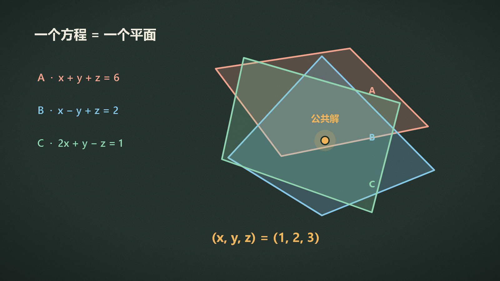
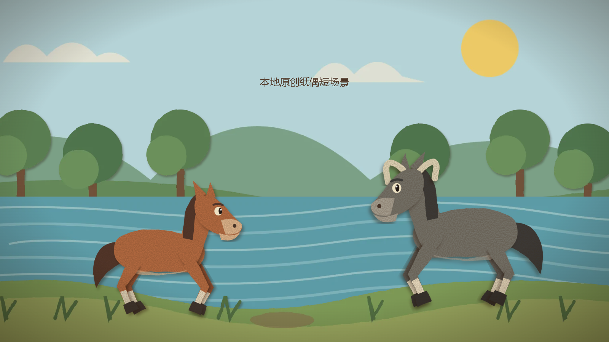
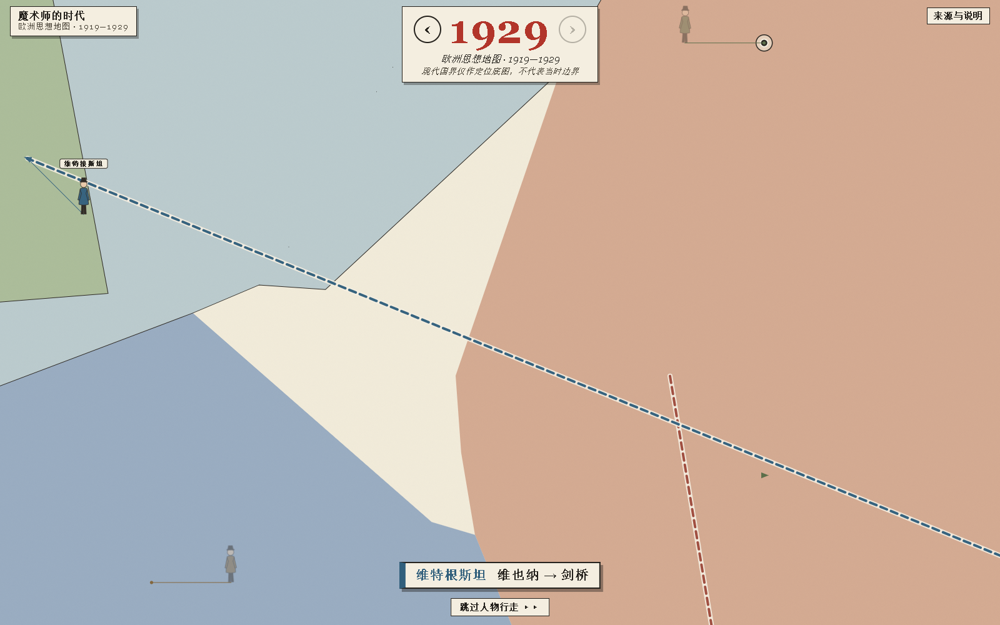
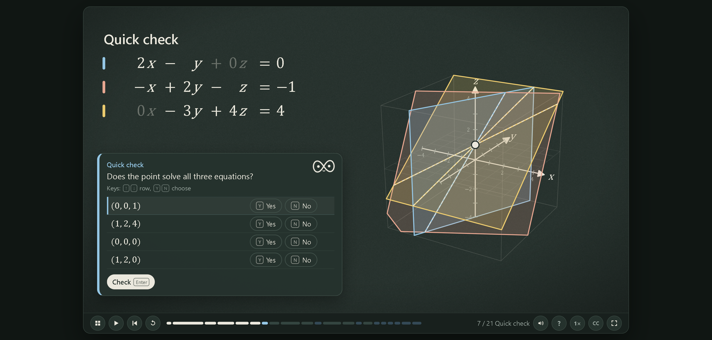
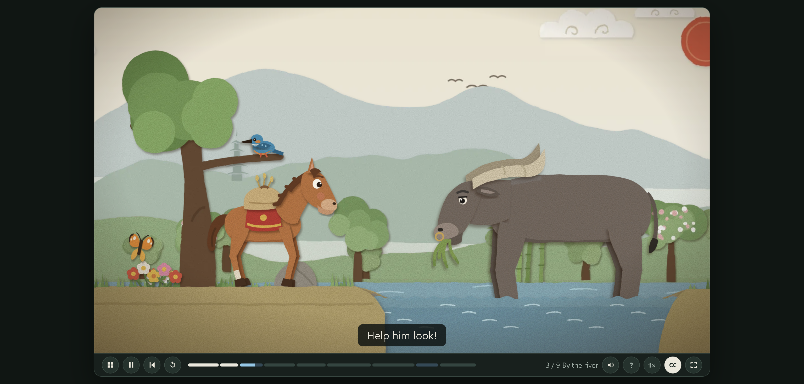
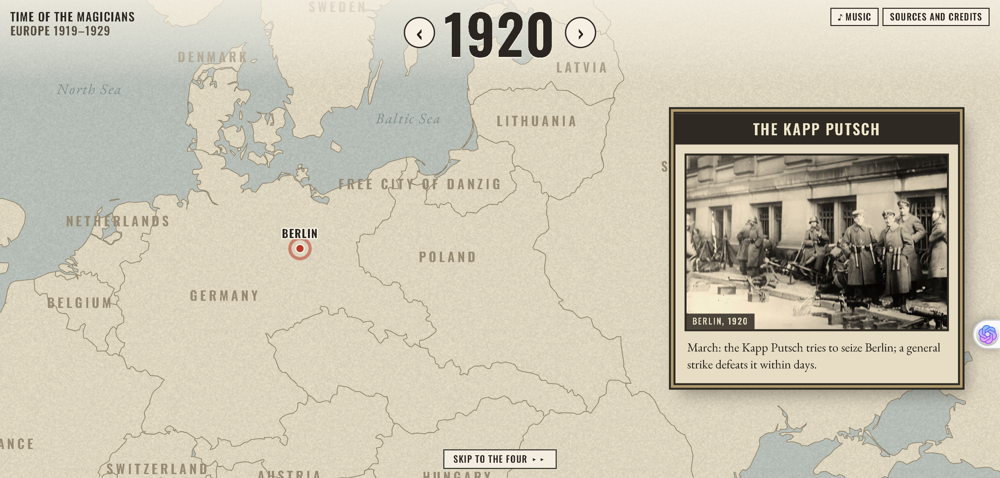

# Papermorph 实测：4 个官方案例与 4 个本地原创试样

一份教材 PDF，怎么变成学生能看、能听、还能答题的课？

一个故事，又怎么从几页文字，变成有角色、有声音、还能让孩子动手找一找的绘本？

最近我打开了一个开源技能 [Papermorph](https://github.com/DozenTwelve/Papermorph)。它没有把自己包装成“一句话出大片”，而是专门解决一件更麻烦的事：把章节、旁白、动画、练习和网页交付连起来。

我核对了它的技能文档、初始化脚本，还逐一打开四个官方案例。它们恰好对应四种真实工作：教数学、做儿童内容、剪知识视频、讲历史。

## 不只是看官方：我在本机也做了四个

为了确认它不只是“官网演示好看”，我在本机写了四个原创中文最小试样，用代码绘制画面，用 Edge TTS 生成配音，没有调用付费 API。

**线性代数互动课**：三个方程变成三个平面，网页里有检查题。



[观看线性代数视频，约 33.47 秒](https://jackssybin.cn/videos/papermorph/linear-algebra.mp4)

**小马过河纸偶绘本**：小马、老牛、河边纸景和抬蹄试水动作都在本地生成。



[观看纸偶绘本视频，约 23.69 秒](https://jackssybin.cn/videos/papermorph/little-horse.mp4)

**《疯癫与文明》短纪录片**：用城镇、船与高墙讲“从放逐到拘禁”。


[观看短纪录片视频，约 45.58 秒](https://jackssybin.cn/videos/papermorph/madness.mp4)

**欧洲思想史互动地图**：1919—1929 年，四位哲学家沿城市路线移动，每年都有事件卡片。



地图以点击阅读为主，所以只交付网页和截图，没有硬剪成视频。现代国界只用于定位。以上都是验证流程的原创小试样，不冒充官方完整案例。

## 数学老师最缺的，不是又一段讲解录像

线性代数里，“三个方程为什么对应三个平面”并不好讲。公式写在纸上，学生还要在脑子里补出空间关系。

Papermorph 的 [Linear Algebra 第 12 章](https://papermorph.diamonddoge.org/linear-algebra/ch12/) 把这个知识点做成了约 14 分钟、21 步的互动课。

我打开第 6 步时，页面里同时有方程、候选解的代入判断和三维平面。进度条后面还有 Quick check、Chapter practice 和 Playground。



这就是它和“把 PDF 喂给视频工具”的差别：学生听完以后，还能检查、练习和回看。官方 README 写着这套课程有 40 章，我这次只核验了第 12 章，不把整套课的完成质量一并打包夸了。

## 儿童绘本，不能只是把插图动起来

[《小马过河》第 1 集](https://papermorph.diamonddoge.org/little-horse/ch01/) 是另一种做法。

这集约 4 分钟、9 个场景，人物和布景采用纸偶式分层。根据官方文档，它还加入了角色配音、音效、音乐，以及让孩子按提示在画面里找人物的 listen-and-find 环节。



对儿童内容作者来说，这个思路很实用：故事仍然按场景往前走，但孩子不总是坐着看，中间也需要动手参与。

我这次打开了河边场景，自动化浏览器没有成功播放声音，所以不对配音效果装熟。技能文档还注明该案例使用 ElevenLabs 配音，想做同类作品时，声音预算要提前算进去。

## 一部纪录片，还能继续拆成竖屏短片

知识类创作者经常遇到一个问题：长内容做完以后，短视频平台还要再做一轮。

Papermorph 的 [Madness and Civilization](https://papermorph.diamonddoge.org/madness/) 系列页提供了一部约 10 分钟的纪录片，同时列出 4 集竖屏短片，每集标注 2 分钟。


这四集不是随便截四段，而是分别围绕 The Ship、Locked Up、Liberation、The Last Voices 展开。长片保留论证，短片各自抓住一个入口，这才是可以复用的内容结构。

系列页还列出了图片、音乐、声音和模型来源。素材里有 Wikimedia Commons 的公共领域和 CC0 作品，也有 ElevenLabs 配音与模型生成的图像、动画。

这点必须说清楚：开源的是制作代码，不代表所有素材和生成步骤都免费，更不代表网上找来的老图片可以直接商用。

## 历史内容，未必非要按时间顺序念完

最后一个案例是 [Time of the Magicians](https://papermorph.diamonddoge.org/time-of-the-magicians/)。

它把欧洲 1919—1929 年做成互动地图。读者可以切换年份，也可以点击 Wittgenstein、Heidegger、Benjamin、Cassirer，查看或收听人物当年的经历。



我在页面上从 1919 切换到 1920，地图内容随之更新。底部还保留了 Sources and credits，方便继续查素材出处。

对历史、地理和博物馆内容来说，这比把年份、地名、人名全部塞进一段旁白自然得多。读者想看哪一年、哪个人，可以自己决定。

## Papermorph 真正省下的，是同步和维护的麻烦

看完这四个案例，我觉得它最值得关注的不是画风，而是两件事。

第一，它用 beats 把旁白和画面动作对齐。说到哪个词，哪个图形出现、移动或变化，都可以按步骤检查。公式、箭头和地图不必依赖视频模型一次猜对。

第二，它用 `style.json` 保存画风、声音、模型选择和已确认章节。后续章节接着沿用，不必每次重新描述角色和风格。每本书还保留自己的播放器引擎副本，上游更新不会直接改写旧作品。

这也解释了它为什么适合做“书”，而不只是做“片”。

## 和普通 AI 视频工具相比，区别在哪？

如果你只想做一条 30 秒的视觉冲击片，通用视频模型可能更直接。Papermorph 更在意另外三件事。

**一是内容能不能拆开维护。** 一本书有章节，一章里有若干步骤。哪一段公式错了，可以回到对应 beat 修改，不必把整条视频重新抽一遍。

**二是读者能不能参与。** 课程的题目、绘本找物、地图点击，都发生在网页里。通用视频工具可以生成一段好看的画面，却不会自动替你补上这些交互。

**三是作品能不能自己留着。** 最终 `site/` 目录是 HTML、JS、CSS、图片和音频，不需要把读者绑在某个生成平台上。你可以自己备份，也可以放到自己的静态网站。

当然，代价也很现实：你要面对的不只是提示词，还有章节结构、分镜、素材授权和浏览器检查。它不是把创作流程消灭了，而是把流程搬到一套可修改的项目里。

## 想试的话，先别喂整本书

Papermorph 需要编程智能体来调用，运行时会用到 `uv`、FFmpeg 和 Playwright。官方提供 Claude Code、OpenCode 安装方式，Codex 用户可安装仓库里的 `.claude/skills/papermorph` 目录。

第一段提示词可以直接这样写：

```text
请使用 papermorph，把这份教材做成中文互动课程。
先只做第 1 章，加入动画、旁白和两道检查题。
开始前先让我确认画风、声音和章节方案，不调用付费 API。
```

第一章出来后，先看内容准不准、字幕齐不齐、画面有没有遮挡，再决定要不要继续。

第一次试验，我更建议选自己写过的一章，而不是网上下载的整本教材。版权问题更简单，你也能马上判断改写是否准确。试样控制在 5—10 分钟，先验证流程，再扩大投入，比一上来生成几十章稳妥得多。

开始之前，最好先问清三个问题：哪些步骤需要付费 API，使用的材料能否公开发布，最终更需要网页互动还是 MP4。这三个答案，会直接影响成本和制作方式。

网页版负责答题、点击和进度记录，MP4 负责分发。课程导出视频时会省略显式答题环节，别把视频当成互动网页的完整替代。

## 我的建议：适合做系列内容的人试，一键出片党先等等

如果你在做系列课程、儿童绘本、知识纪录片或人文地图，Papermorph 很值得用一个章节试水。

如果你只想输入一句话，马上拿一条视频去发布，这套流程可能显得太重。风格确认、素材授权、配音和审看都要花时间，生成章节也只是初剪。

它更像一套互动书制作框架，而不是另一个视频模板。官方案例展示完整形态，本地试样验证了中文内容、动画、配音、截图和 MP4 的真实流程；值不值得用于你的材料，还是要靠自己的第一章判断。

---

我是「开源日拱一卒」，一个只信自己跑过、核过的开源/AI 工具实测派。每次帮你筛一个能真正省钱、省时间的项目，坑我先替你踩。

觉得有用，点个「在看」并**星标**公众号，下次更新不迷路。项目地址和案例入口我放在了「**阅读原文**」。

相关阅读（官方案例）：

- [Linear Algebra：Three Planes, One Point](https://papermorph.diamonddoge.org/linear-algebra/ch12/)
- [Madness and Civilization：纪录片与竖屏短片](https://papermorph.diamonddoge.org/madness/)
- [Papermorph 官方示例书架](https://papermorph.diamonddoge.org/)

#Papermorph #开源工具 #AI课件 #互动绘本 #知识视频
