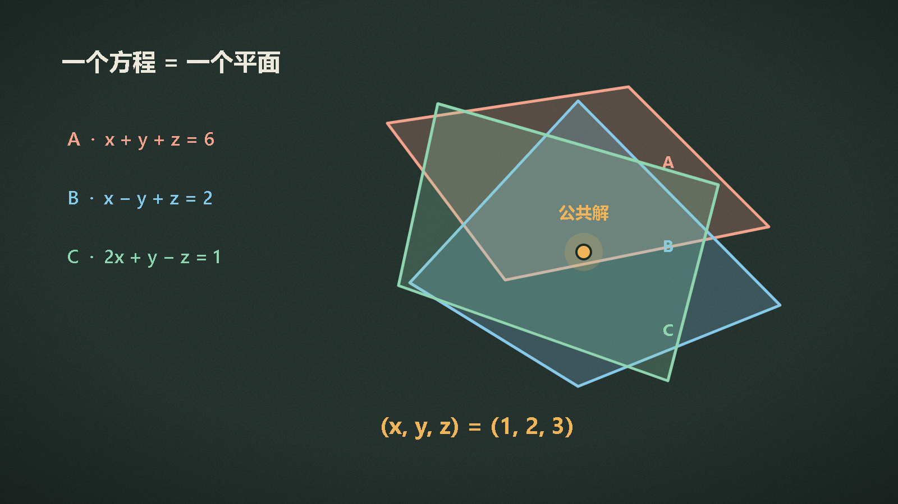
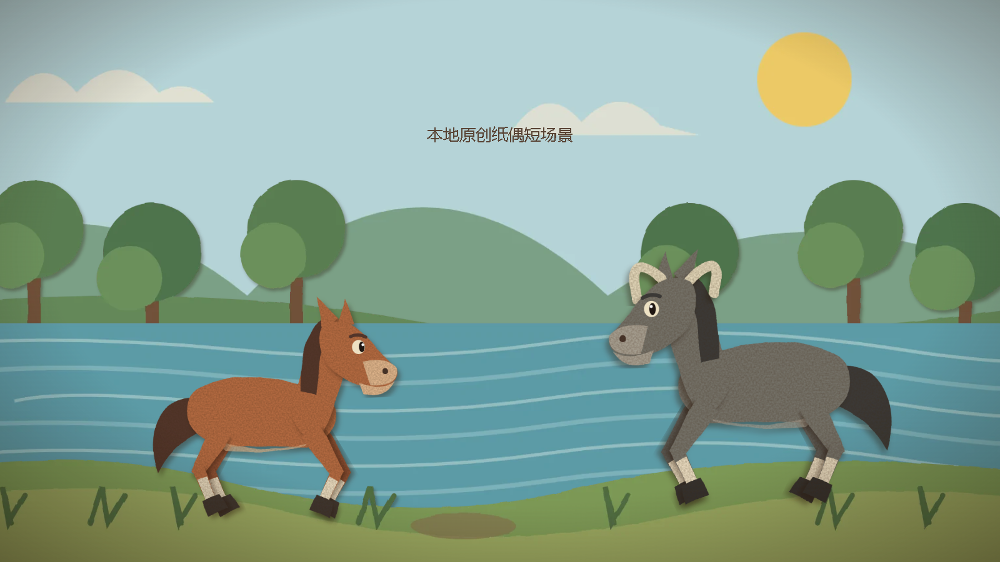
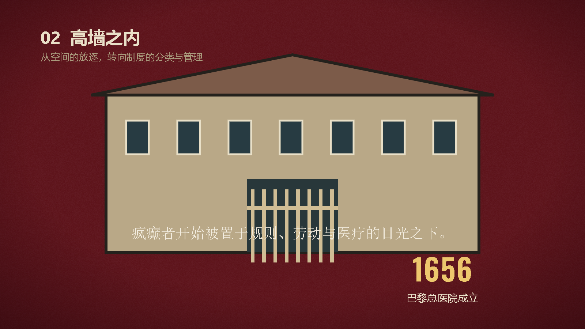
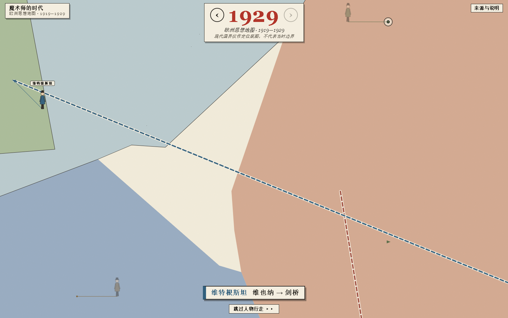
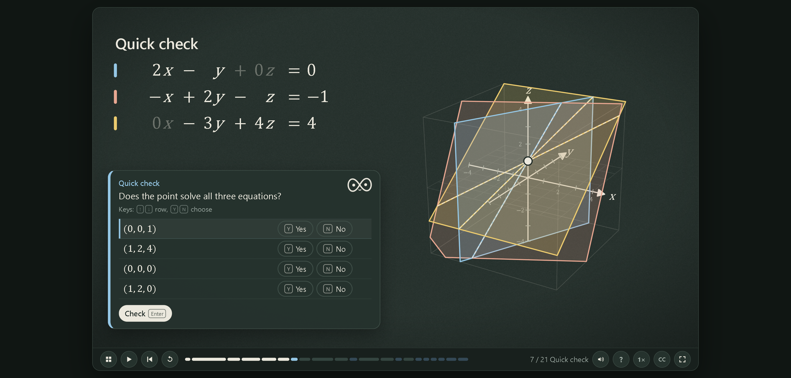
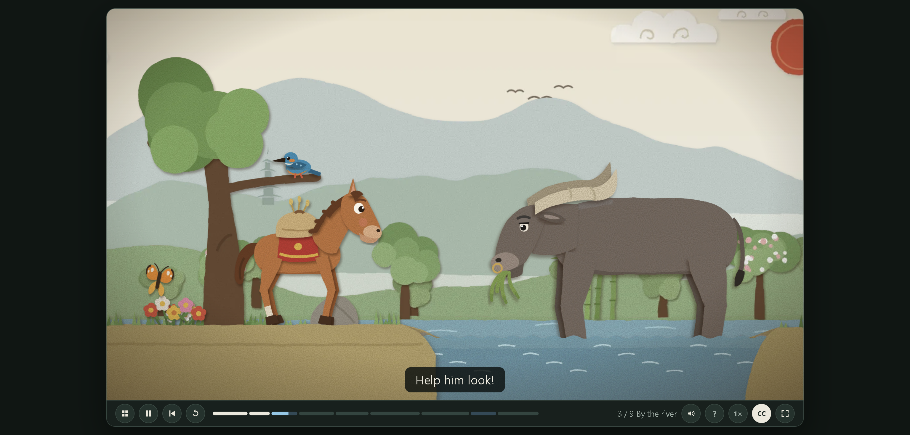
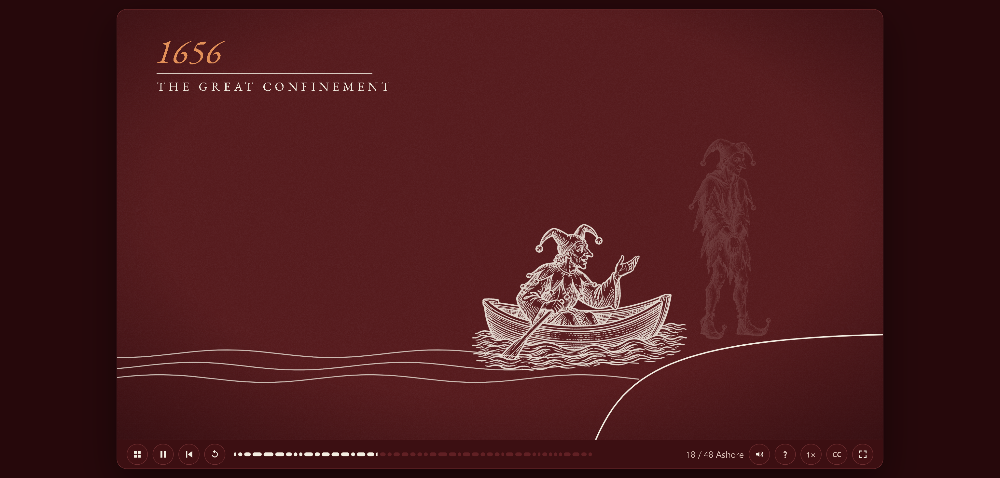
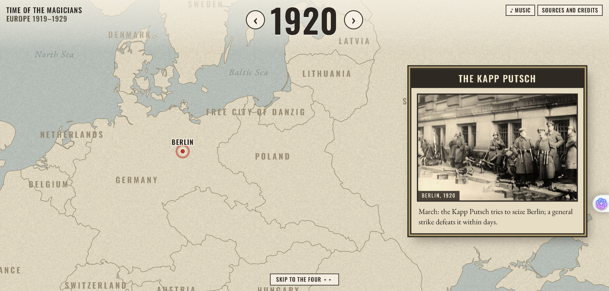

# Papermorph 值得试吗？4 个官方案例与 4 个本地原创实测

如果你的目标是把教材、故事或书籍做成带旁白、动画和网页互动的系列作品，Papermorph 值得试；如果只是想把一句话快速变成视频，它未必是最轻的选择。

我核对了 [Papermorph](https://github.com/DozenTwelve/Papermorph) 的技能文档、初始化脚本和四个官方案例。它最突出的地方不是单项生成能力，而是把章节规划、分镜、声音、画面、题目和静态交付放进了同一套流程。

下面用案例说明它适合解决什么问题，以及哪些宣传话术需要打折扣。

## 先给本地实测结果：四个原创最小试样已经跑通

为了避免只复述官方页面，我在本机实际制作了四个中文试样。画面由代码绘制，旁白使用 Edge TTS，没有调用付费 API。下面的图片与 MP4 都是本地真实导出。

- **互动课程**：三个平面与一个公共解，网页含两道检查题。[观看视频](https://jackssybin.cn/videos/papermorph/linear-algebra.mp4)
- **纸偶绘本**：小马与老牛在河边对话，带角色配音与抬蹄试水动作。[观看视频](https://jackssybin.cn/videos/papermorph/little-horse.mp4)
- **短纪录片**：《疯癫与文明》主题，从放逐意象讲到拘禁制度。[观看视频](https://jackssybin.cn/videos/papermorph/madness.mp4)
- **互动地图**：1919—1929 年四位哲学家的城市路线，交付网页与截图，不配语音、不导出视频。









这些是验证流程的最小作品，不是官方完整案例的复刻。地图使用 Natural Earth 底图，现代国界仅作定位。

## 1. 数学课程：讲解之后，还要有检查与练习

官方 [Linear Algebra 第 12 章](https://papermorph.diamonddoge.org/linear-algebra/ch12/) 讲的是三个方程、三个平面与一个公共解。

页面标注约 14 分钟、21 步。我打开的第 6 步同时呈现方程、候选解的代入结果和三维平面；后续步骤包含 Quick check、Chapter practice 和 Playground。



这个结构比“把讲义配图后读一遍”更有价值。数学讲解需要读者在某个节点停下来检查理解，视频本身并不擅长处理这件事，网页则可以保留题目、步进和练习。

官方 README 列出整套课程 40 章。这里只核验第 12 章，不把项目方的全量介绍当成自己的逐章实测。

## 2. 儿童绘本：人物表演之外，还可以加入找物互动

[《小马过河》第 1 集](https://papermorph.diamonddoge.org/little-horse/ch01/) 标注约 4 分钟、9 个场景，采用纸偶式人物与布景。



官方文档还列出了角色配音、音效、音乐，以及让孩子按提示寻找画面人物的 listen-and-find 环节。对低幼内容来说，这种“看一段、参与一下”的节奏比连续播放更贴合使用场景。

需要保留两个边界：我这次只核验了页面与文档，自动化环境未成功播放声音；技能说明注明该案例使用 ElevenLabs，因此不能把同类绘本的配音成本默认为零。

## 3. 知识纪录片：长内容与竖屏短片可以共享同一主题结构

[Madness and Civilization](https://papermorph.diamonddoge.org/madness/) 系列页提供约 10 分钟的纪录片，以及 4 集各 2 分钟的竖屏短片。



四集分别以 The Ship、Locked Up、Liberation、The Last Voices 为入口。这种拆分方式对知识创作者更有参考意义：长片保留完整论证，短片各自承担一个具体叙事，不是把长片机械裁成四段。

系列页同时公开了素材来源和许可。图片、音乐包括 Wikimedia Commons 的公共领域与 CC0 作品，声音和部分生成素材则使用了 ElevenLabs、图像模型及视频模型。

因此，评价这类工具时不能只看“能不能生成”。素材是否可以再分发、不同版本如何保留来源、付费服务在哪一步参与，同样影响最终交付。

## 4. 历史地图：让读者自己选择年份与人物

[Time of the Magicians](https://papermorph.diamonddoge.org/time-of-the-magicians/) 将欧洲 1919—1929 年做成互动地图，提供四位哲学家的点击入口。



我实际从 1919 切换到 1920，页面年份与地图内容随之变化。页面还保留 Sources and credits，便于追溯地图、音乐和历史图片。

这个案例说明，Papermorph 的输出不必是线性影片。对于历史、地理或博物馆内容，作者可以把资料组织成读者自行探索的页面，减少长篇旁白里的时间和地名堆叠。

## 它为什么能维持多种作品的一致性？

从技能文档看，有三个设计值得注意。

**其一是 beats。** 旁白切片与定时动作配对，画面放在 SVG 舞台上。哪个词触发哪个图形、箭头或镜头变化，可以逐段检查。相比完全依赖视频模型生成连续镜头，这种方式更容易修正公式、标注和地图细节。

**其二是 style.json。** 受众、画风、声音、模型和已确认章节会写入这个文件。后续章节沿用已经同意的决定，避免每一章都重新建立风格。

**其三是每本书保留自己的引擎副本。** 上游播放器更新时，旧作品不会因为引用同一个全局脚本而立即改变。配合 `books/`、`content/`、`tools/`、`site/` 的目录分离，制作资料与公开成品也能保持边界。

这些设计不显眼，却决定了它能不能支持多章节维护，而不仅是做出一个好看的演示。

## 和普通 AI 视频工具怎么选？

两类工具处理的对象不同。通用视频模型更适合根据提示词生成连续镜头，Papermorph 更适合维护一个由许多网页对象、旁白片段和交互步骤组成的项目。

如果一条片子里的人物、构图和氛围是重点，视频模型往往更直接；如果公式必须准确、箭头要在某个词出现、读者还要答题或点击地图，Papermorph 的确定性更容易检查。

修改方式也不同。前者经常需要围绕提示词重新生成，后者可以回到具体章节、beat 或样式文件修改。对一次性短片来说，这种项目结构可能显得繁琐；对几十章课程来说，它反而能减少后续维护的混乱。

交付形态同样影响选择。Papermorph 的 `site/` 目录可以自行备份和托管，不依赖某个生成平台持续提供服务；但它也要求作者处理静态部署、素材授权和浏览器兼容检查。

## 网页与 MP4 不是同一种交付

Papermorph 生成的是静态网页，不需要应用后端或数据库，进度保存在浏览器本地。章节也可导出 1080p MP4 和 SRT。

不过，网页互动无法完整进入视频。官方导出说明明确指出，课程视频会省略答题环节。更合理的分工是：网页用于学习和探索，MP4 用于视频平台分发。

## 上手时，建议把试验缩小到一章

官方为 Claude Code 和 OpenCode 提供安装命令；Codex 用户可以安装仓库中的 `.claude/skills/papermorph` 目录。运行依赖包括 `uv`、FFmpeg 和 Playwright 浏览器。

一个稳妥的提示词是：

```text
请使用 papermorph，把这份教材做成中文互动课程。
先只做第 1 章，加入动画、旁白和两道检查题。
开始前先让我确认画风、声音和章节方案，不调用付费 API。
```

不要先用整本书测试。第一章至少需要检查事实、字幕同步、空白画面、文字遮挡和交互是否正常。技能文档把生成章节定义为初剪，这个提醒很必要。

## 结论

Papermorph 更适合系列课程、儿童绘本、知识纪录片和人文互动页面。它的优势在于统一风格、声音画面同步、网页交互和可持续维护，而不是“一键生成”。

如果你只需要一条快速成片，这套流程会显得复杂；如果你本来就在同时维护文案、配音、动画、题目和网站，它可能恰好把这些散落的步骤接到了一起。

项目与案例入口：

- [Papermorph GitHub](https://github.com/DozenTwelve/Papermorph)
- [官方示例书架](https://papermorph.diamonddoge.org/)

以上页面与数据核验于 2026-11-13。四个本地原创试样已于同日实际生成、导出并检查；未调用付费 API，未声称完成整本课程、整集绘本或完整长纪录片。
