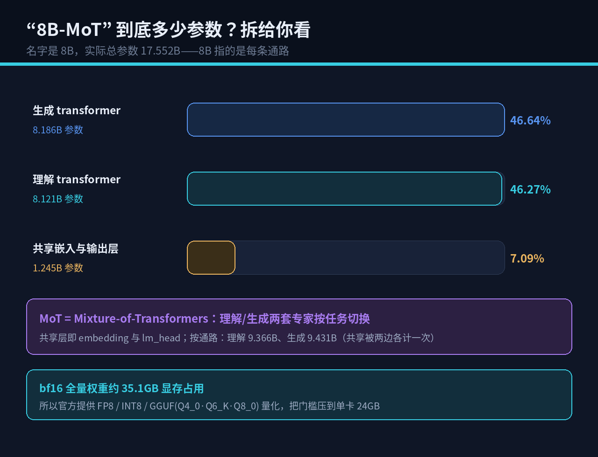
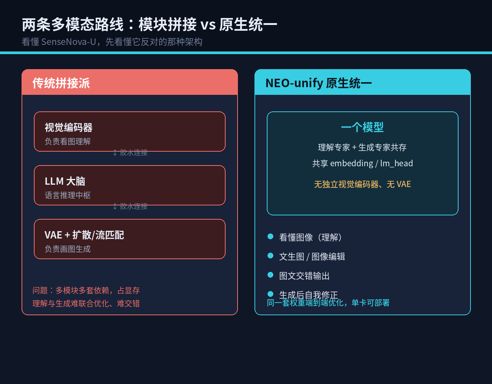
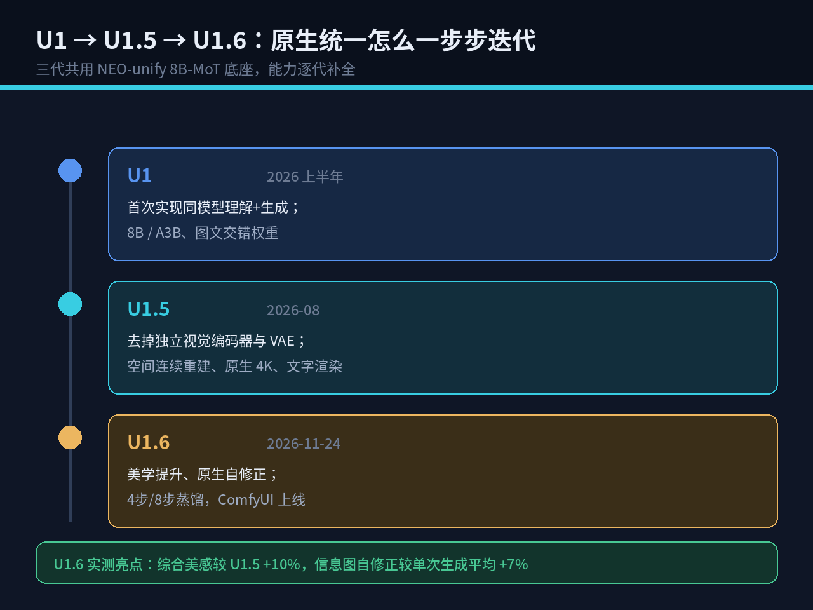
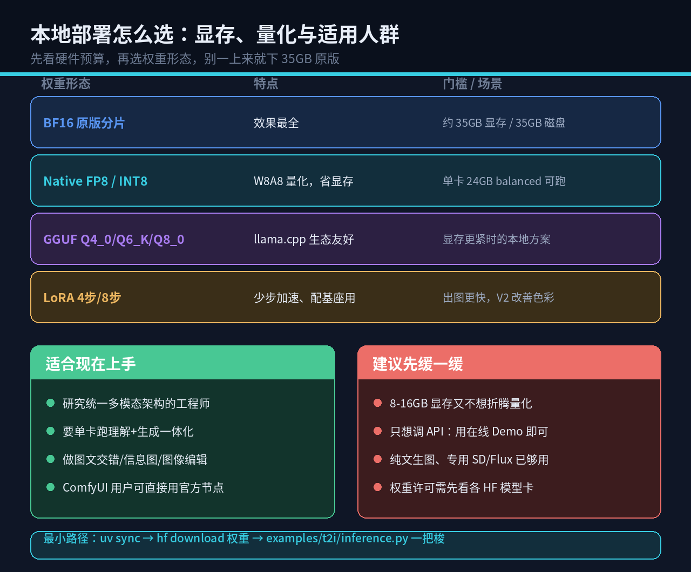

评价商汤 SenseNova-U 之前，我先把仓库克隆到本地逐文件核验了一遍，因为它最容易引起误解的恰恰是名字：标称 8B-MoT，实际总参数是 17.552B。这个命名差异不是营销话术，而是理解整套 NEO-unify 架构的入口。

## 一、8B 实为 175 亿：先厘清参数口径

仓库自带参数分解文档和检查脚本，加载权重后可自行统计。我核对的结果是：总参数 17.552B，bf16 下约占 35.1GB，由生成 transformer 8.186B（46.64%）、理解 transformer 8.121B（46.27%）、共享层 1.245B（7.09%，即 embedding 与 lm_head）构成。按激活通路算，理解通路 9.366B、生成通路 9.431B，共享层被两边各计一次。

这里的 MoT 是 Mixture-of-Transformers 而非常见的 MoE：理解与生成是两套独立 transformer 专家，运行时按任务激活其中一套，并共享文本输入输出。所以 8B 描述的是单条通路的量级，不是全模型规模。做显存规划若只看名字，必然低估一半。

## 二、原生统一与模块拼接的根本差异

多模态此前的主流做法是拼接：独立视觉编码器负责理解、LLM 负责推理、VAE 加扩散或流匹配负责生成，三个模块靠适配层连接。这套方案工程上成熟，但理解与生成的训练目标不一致、难以端到端联合优化，图文交错需要跨模块搬运，且多份权重推高显存。

NEO-unify 把理解专家与生成专家放进同一模型、共享 embedding 和 lm_head。U1.5 起进一步移除独立视觉编码器和 VAE，改用无 VAE 视觉路径与空间连续性重建，以 flow-matching 做生成并支持原生 4K。我在 src 的 neo_unify 目录确认，理解与生成的建模代码同属一套模型实现，而非两个独立项目拼接。

去掉 VAE 的意义在于：传统扩散依赖 VAE 在像素与隐空间之间压缩还原，既耗算力又丢细节；统一视觉表征让"看图"和"画图"对齐到同一表示空间，减少一次翻译，更利于编辑一致性和图文交错。

## 三、统一架构的独特红利：原生自修正

U1.6 最能体现这条路线价值的能力是自修正。拼接方案要实现"生成后检查再改"，通常需要外部 agent 循环，让另一个模型读图、找错、回调生成接口。而 U1.6 因为同一模型兼具理解与生成能力，可以在一次生成内完成"生成—检查—修改"：产出信息图后对照原始提示词自查文字模糊、错字、乱码、编号错误，再直接出修改稿。

官方数据是综合美感较 U1.5 提升 10%，UltraTextBench 高文字密度任务上自修正比单次生成平均相对提升 7%。需要说明这是官方基准与主观评测口径，第三方独立复现仍待观察。

三代的分工很清楚：U1 验证同模型理解加生成可行；U1.5 完成去视觉编码器、去 VAE 的架构升级，补 4K 与文字渲染；U1.6 在同底座上强化美学与自修正，并发布 4 步、8 步蒸馏模型、上线 ComfyUI。

## 四、工程成熟度与本地部署门槛

这不是一个只有推理脚本的发布包。实测 src 推理代码约 1.1 万行，training 训练代码约 5.18 万行，另有 13 个测试文件，覆盖 CFG 批处理、生成式 RoPE、分组矩阵乘、层卸载、量化产物、GGUF 加载等关键环节。示例含文生图、图像编辑、图文交错、视觉问答、服务化五类，直接依赖仅 12 个，用 uv 锁定 Python 3.11 环境，文档 45 篇中 22 篇有中文版，还提供 AGENTS.md 作为 AI 编程助手入口。

部署上，官方 balanced 配置目标是单卡 24GB 显存加 64GB 内存，另需约 35GB 磁盘。权重分四档：BF16 原版效果最全但需 35GB 显存；Native 的 FP8/INT8（W8A8）适配 24GB 单卡；GGUF 的 Q4_0/Q6_K/Q8_0 面向 llama.cpp 生态和更紧显存；4 步/8 步 LoRA 用于加速且必须搭配基座。能把 35GB 全量权重压进 24GB，依赖的是 layer_offload、quant_runtime、gguf_loader 这套分层卸载与运行时量化工具，而非单纯降低精度。

## 五、适用边界

适合的使用者包括：研究统一多模态架构、需要可读训练代码的算法工程师；要在单卡上同时做理解、生成、编辑、图文交错的开发者；做信息图与海报、希望用自修正降低返工的团队；以及可直接使用官方 ComfyUI 节点的用户。

应当谨慎的情况：仅有 8 到 16GB 显存且不愿折腾量化的人，Q4 仍偏紧，可等更小的社区蒸馏版；只需要 API 调用的，用在线 Demo 即可，不必克隆；纯文生图、追求出图量而不需要理解能力的，成熟的 SD、Flux 生态可能更合适。

最后是许可：代码为 Apache-2.0，但模型权重的使用条件以各 HuggingFace 模型卡为准，两者独立，商用前需单独确认。整体看，SenseNova-U 的核心贡献不是某一种出图风格，而是用一个可本地运行的完整开源工程，证明了理解与生成共用原生模型这条路线在单卡条件下的可行性；那个"8B 实为 175 亿"的命名误会，恰好是理解 MoT 双专家如何共享一套底座的最好起点。

项目地址：https://github.com/OpenSenseNova/SenseNova-U1
