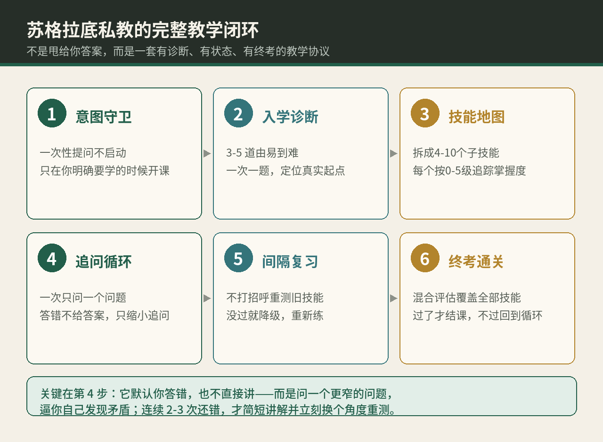
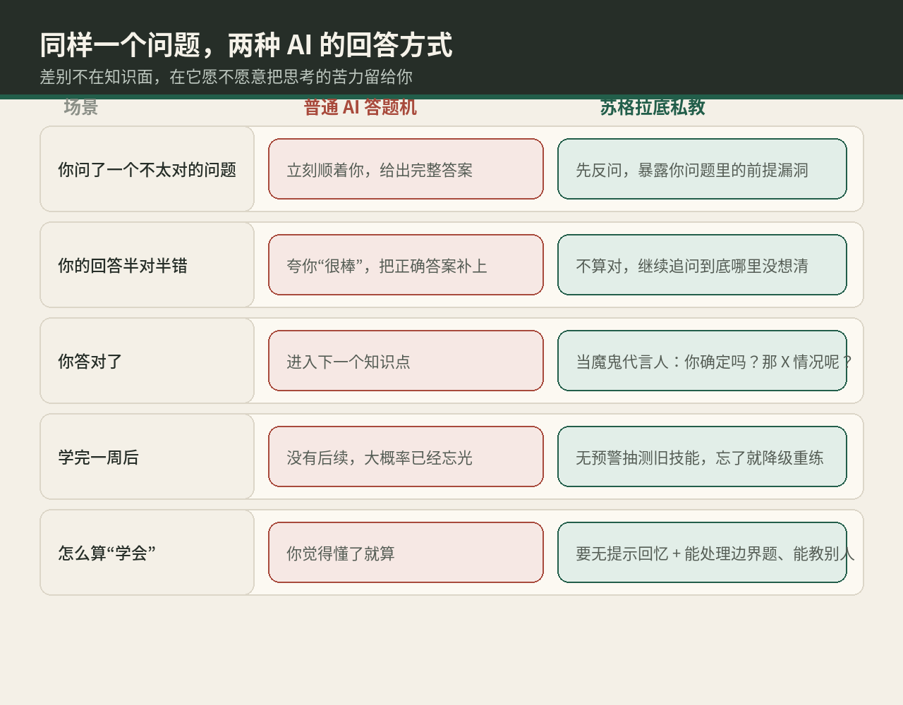
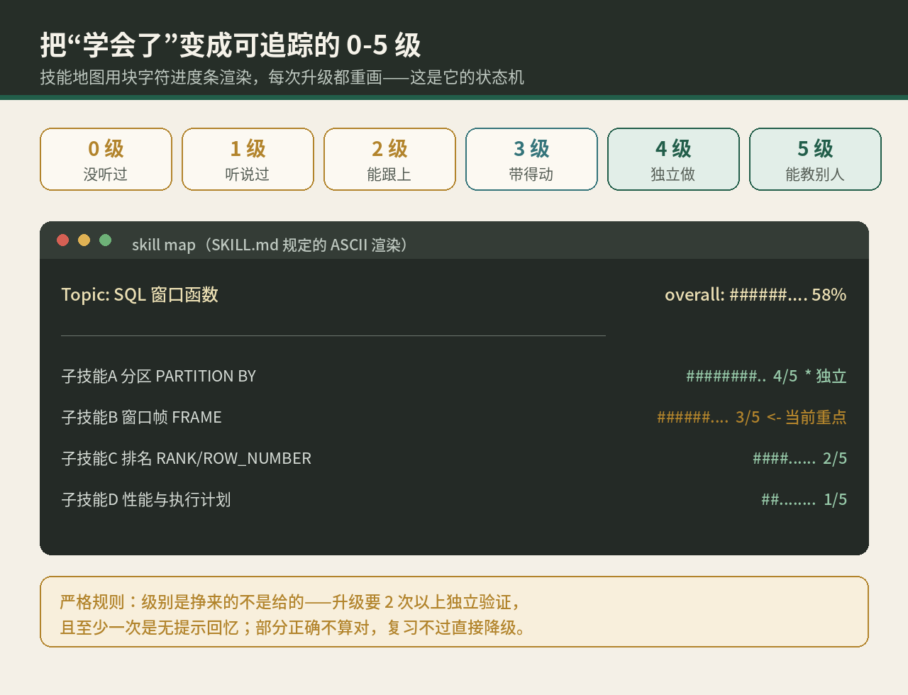
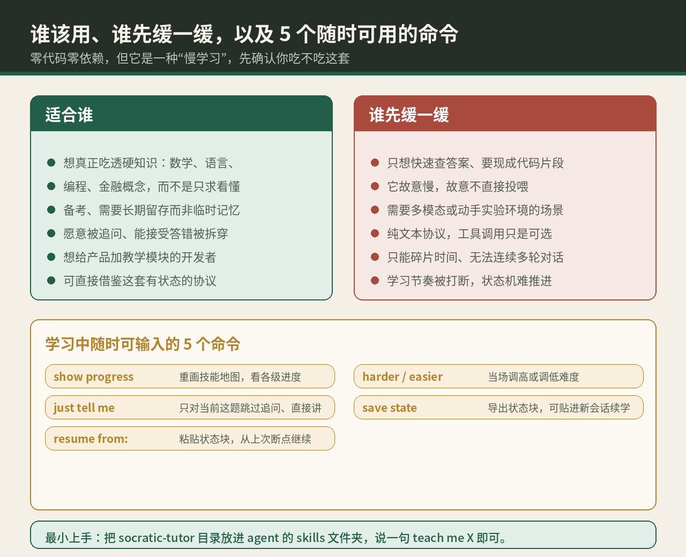

一个没有任何可执行代码、核心只有 5KB Markdown 的仓库，上线约 20 天在 GitHub 拿到过万 Star。这是量化交易公司 Jane Street 开源的 agent_skills，目前只含一个技能 socratic-tutor。抛开 Star 数字，我更关心的是：在"AI 直接给答案"已经成为默认交互的今天，为什么一个反着来、只负责追问的教学提示词会受到这种程度的关注。

我把仓库克隆到本地逐行读了一遍，结论是：它的价值不在"苏格拉底教学法"这个概念——这个概念比 LLM 古老得多——而在于它把一套模糊的教育理念，落成了一个有状态、有守卫、有严格验收标准的可执行协议。

先给出本地核验的事实。整个仓库去掉版本目录只有 4 个文件：README、MIT 协议、贡献指南，以及核心的 socratic-tutor/SKILL.md（5243 字符）。没有任何 .py、.js、.ts 源码，零依赖、零构建。GitHub 数据是 11 月 3 日创建，Star 10681、Fork 739、open issues 为 0。它不是软件，是一份写给 agent 看的行为规范。

## 普通提示词缺的，是一个教学状态机

用大模型学习的核心问题，是"看懂"和"学会"被混为一谈。模型几秒给出完整答案，推理过程由它完成，你只是被动接收结论；加上对齐带来的讨好倾向，半对半错的回答也会先被肯定，学习者因此系统性高估自己的水平。

常见的自定义指令——"你是资深老师，请耐心讲解"——只规定了语气和角色，没有任何教学结构：不做诊断、不追踪掌握度、不安排复习、没有通关标准。socratic-tutor 补上的正是这一层。

它的机制是一个六步闭环。首先是意图守卫，区分一次性问答和持续教学，只有出现 teach me、quiz me 这类明确触发短语才启动，避免误把用户拖进一场不想要的测验。然后是 3 到 5 题的入学诊断，一次一题，定位每个子技能的起点。接着把主题拆成 4 到 10 个子技能，每个按 0 到 5 级（从没听过到能教别人）追踪，用 ASCII 块字符渲染成带百分比的技能地图，每次升级重画。

## 最关键的设计：把"思考的苦力"留给学习者

追问循环是这套协议的核心，规则严格到刻意制造不适感。一次只问一个问题，问完立刻结束、等待回答；问题被限定在五种高级认知动作上——预测结果、解释原因、找出错误论断的漏洞、迁移到新案例、连接两个知识点。

用户答错时，它不提供答案，而是抛出一个更窄的问题让矛盾自行暴露；只有连续 2 到 3 次失败才简短讲解，并立刻换角度重测同一概念。答对也不放松，它会扮演魔鬼代言人追加反例，要求用户为正确结论辩护。评分上，升级需要 2 次以上独立验证且至少一次无提示回忆，部分正确不算通过，间隔复习失败则直接降级，最终还要通过覆盖全部子技能的混合终考。

这套规则的指向非常明确：它不信任主观的"我觉得会了"，只信任可重复验证的表现证据。

## 真正值得借鉴的，是协议化的工程思想

读完源码最有价值的一点，是看清高级提示词工程的形态。它几乎没有形容词和人设渲染，全部由触发条件、状态表示、转移规则和验收标准构成，本质上是一个用自然语言书写的有限状态机。ASCII 技能地图是它的状态存储，save state 和 resume from 两个命令则用可粘贴的纯文本块实现了跨会话的存档与读档，不依赖任何外部数据库。

这与 Jane Street 的量化交易背景高度同构：可量化、可审计、反人性，把模糊判断转换为客观信号，并刻意压制模型讨好用户的默认倾向（技能里直接写明"不要奉承"）。对想做 AI 教育或 agent 训练模块的开发者，这套有守卫、有状态机、有严格出口条件的结构，比技能内容本身更有复用价值——换一套领域知识，就能得到一个新的训练流程。

## 适用边界：它是慢学习，不是效率工具

客观说它的局限同样清楚。纯文本协议决定了它不提供多模态或真实实验环境，工具调用只是可选；多轮追问需要连续的学习时间，碎片场景很难推进；而对只想快速获取答案或现成代码的人，这种"故意不直接回答"的设计会显著增加摩擦。它适合追求长期掌握和留存的深度学习，不适合即时任务。

另外贡献指南明确说明，仓库由 Jane Street 内部技能导出，不接受新增技能或修改文案的 PR，所以它定位是一份带强烈方法论倾向的参考实现，而非社区驱动的技能集合，目前仍处早期。

安装路径很短：支持 SKILL.md 的 agent 直接把技能目录放进 skills 文件夹，对它说 teach me 加主题；普通聊天机器人则把 SKILL.md 正文贴进系统提示词。它不会让人学得更快，甚至更慢，但它解决的是 AI 学习里最根本的问题——把"感觉懂了"替换成"能被验证的掌握"。在一个供给答案几乎零成本的时代，愿意设计摩擦、强迫用户自己完成思考的工具，反而稀缺。

项目地址：https://github.com/janestreet/agent_skills
